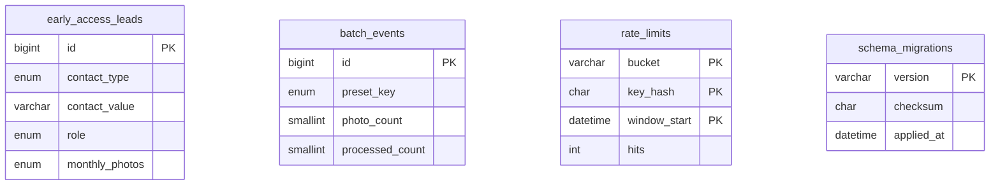

# Database design

## 1. Engine

MySQL (Hostinger), compatible with **MySQL 8.0.16+** and **MariaDB 10.6+**. InnoDB, `utf8mb4` / `utf8mb4_unicode_ci`. Tested on MariaDB 10.11.14.

## 2. Organisation

One database, created in hPanel (Hostinger prefixes the name, e.g. `u123456789_idoconverter`). Four tables:

| Table | Purpose | Personal data |
|---|---|---|
| `early_access_leads` | One row per person who asked for early access | **Yes**: email or phone, optional note |
| `batch_events` | One anonymous summary per processed batch | No |
| `rate_limits` | Hourly request counters per HMAC'd client key | No (irreversible hash) |
| `schema_migrations` | Applied migration versions and checksums | No |

## 3. Relationships

**There are no foreign keys, by design.** Batch events are deliberately not linked to leads: linking would make anonymous statistics personal data. Rate-limit rows are unrelated to both.

## 4. Tables

### early_access_leads

| Column | Type | Null | Default | Notes |
|---|---|---|---|---|
| id | BIGINT UNSIGNED AUTO_INCREMENT | no | — | PK |
| contact_type | ENUM('email','phone') | no | — | |
| contact_value | VARCHAR(254) | no | — | Normalised: lower-case email, or `+91XXXXXXXXXX` / E.164 |
| role | ENUM('seller','cataloguer','agency','other') | no | — | |
| sells_amazon, sells_flipkart, sells_meesho, sells_other | TINYINT(1) | no | 0 | Flags (booleans); at least one must be 1 |
| monthly_photos | ENUM('under_50','50_200','200_1000','over_1000') | no | — | |
| note | VARCHAR(500) | yes | NULL | Free text, optional |
| source | ENUM('home','tool','guide') | no | — | Which page the form was on |
| consent_version | VARCHAR(16) | no | — | Version of the consent text shown |
| consent_at | DATETIME(3) | no | — | UTC; refreshed on every submission |
| submissions | SMALLINT UNSIGNED | no | 1 | Incremented on resubmission (capped at 65,535) |
| created_at / updated_at | DATETIME(3) | no | CURRENT_TIMESTAMP(3) | UTC; set by the app |

Constraints:
- `UNIQUE uq_leads_contact (contact_type, contact_value)`: one row per person, case-insensitive through the collation
- `ck_leads_contact_len`: 5–254 characters
- `ck_leads_flags`: each flag 0 or 1
- `ck_leads_any_market`: at least one marketplace
- `ck_leads_submissions`: at least 1
- `ck_leads_times`: `updated_at >= created_at`

Index `ix_leads_created (created_at)` supports export ordering and retention deletes.

### batch_events

| Column | Type | Null | Default |
|---|---|---|---|
| id | BIGINT UNSIGNED AUTO_INCREMENT | no | PK |
| created_at | DATETIME(3) | no | CURRENT_TIMESTAMP(3) |
| preset_key | ENUM('amazon','flipkart','meesho','custom') | no | |
| photo_count | SMALLINT UNSIGNED | no | |
| processed_count | SMALLINT UNSIGNED | no | |
| pass_count, check_count, fail_count | SMALLINT UNSIGNED | no | |
| duration_ms | INT UNSIGNED | no | |
| output_size | SMALLINT UNSIGNED | no | |
| device_class | ENUM('mobile','tablet','desktop') | no | |
| used_worker, cancelled | TINYINT(1) | no | |
| used_samples | TINYINT(1) | no | 0 |

Constraints:
- `ck_batch_photos`: 1–100 photos
- `ck_batch_processed`: processed ≤ photos
- `ck_batch_sum`: pass + check + fail = processed
- `ck_batch_duration`: at most 1 hour
- `ck_batch_size`: output size 500–5000
- `ck_batch_flags`: each flag 0 or 1

Indexes: `ix_batch_created (created_at)` for weekly reports and retention; `ix_batch_preset_created (preset_key, created_at)` for per-marketplace reports.

### rate_limits

| Column | Type | Notes |
|---|---|---|
| bucket | VARCHAR(32) ascii_bin | `early_access`, `batch_event` |
| key_hash | CHAR(64) ascii_bin | HMAC-SHA256(client IP, `IP_HASH_SECRET`), hex |
| window_start | DATETIME | UTC, start of the hour |
| hits | INT UNSIGNED, default 1 | |

PK `(bucket, key_hash, window_start)` makes the counter update atomic (`INSERT … ON DUPLICATE KEY UPDATE hits = hits + 1`). Index `ix_rate_window` supports cleanup. Constraint `ck_rate_hash` requires exactly 64 characters.

### schema_migrations

Created by `scripts/db-migrate.mjs`: `version` (PK), `checksum` (SHA-256 of the file), `applied_at`.

## 5. Conventions

- All timestamps are **UTC** `DATETIME(3)`; the pool runs with `timezone: "Z"`. `TIMESTAMP` is avoided (2038 limit and session-timezone conversion).
- Booleans are `TINYINT(1)` with CHECK constraints.
- ENUMs are used for small, closed sets that change only with a migration.
- No JSON columns (MariaDB stores JSON as LONGTEXT; behaviour differs from MySQL).

## 6. Retention and deletion

**Hard deletion only.** Soft-deleting personal data would keep it, so there are no `deleted_at` columns.

| Data | Kept for | How |
|---|---|---|
| Leads | 12 months after last update, or until a deletion request | `database/queries/retention.sql`, `delete_person.sql` |
| Batch events | 24 months | `retention.sql` |
| Rate-limit rows | Under 1 day | Automatic opportunistic cleanup, plus `retention.sql` |

Policy: `docs/DATA_RETENTION.md`.

## 7. Migrations

- Versioned files `NNNN_description.sql`, applied in order, never edited after being applied. The runner refuses changed checksums (tested).
- MySQL DDL commits implicitly, so migrations aren't transactional. They use `CREATE … IF NOT EXISTS`, so a partly applied file can be re-run.
- Rollbacks live separately in `database/rollback/` and are **destructive**. They're never run by scripts, and need owner approval plus a backup.
- Future changes must be additive. To remove a column: stop using it in code, deploy, back up, then drop it in a new migration.

## 8. Backup and recovery

- Hostinger's automatic backups cover databases; check the frequency and retention for your plan in hPanel.
- Before any migration or retention delete, export the database in phpMyAdmin (or `mysqldump --single-transaction`) and confirm the file opens.
- To recover: create an empty database, import the backup, then run `npm run db:migrate` and `npm run db:verify`.

## 9. Queries and transactions

- All writes are single statements, so atomicity comes from InnoDB per statement. Concurrent duplicate sign-ups are serialised by the unique key (tested with 8 concurrent requests).
- Reports (`database/queries/validation_metrics.sql`) use the `created_at` indexes; data volumes are small.

## 10. Access control

MySQL has no row-level security. Isolation comes from:
- the application user getting only DML rights on this database
- no admin web UI
- server-only credentials

A separate migration user with DDL rights is recommended.

## 11. Future extensions (designed, not created)

Add these only when the features are approved. Sketch:

- `users` (id, email UNIQUE, created_at, deleted_at for account-deletion grace) — or tables owned by the chosen auth library
- `sessions` (id, user_id → users ON DELETE CASCADE, expires_at), if the auth library needs them
- `saved_workflows` (id, user_id → users ON DELETE CASCADE, name, preset_key, settings columns, UNIQUE(user_id, name))
- `subscriptions` (user_id, plan, status, current_period_end, provider_ref UNIQUE)
- `usage_ledger` (id, user_id, kind, delta, idempotency_key UNIQUE, created_at): credits as an append-only ledger
- `payment_events` (provider_event_id UNIQUE, type, received_at, processed_at): webhook de-duplication
